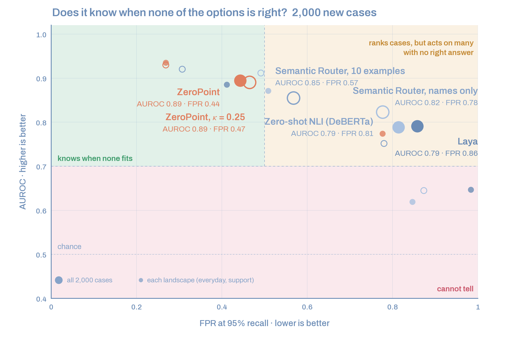

# Benchmark

What the two landscapes that ship with ZeroPoint (`everyday` and `support`) do on cases they never saw, against a similarity baseline with the same encoder
and against [Laya](https://pypi.org/project/laya/), a published decision model. Everything here can be
rebuilt from public data with the scripts in [benchmarks/](benchmarks) and
[scripts/build_presets.py](scripts/build_presets.py).

## The question

A decision engine has two jobs. When the right option is on the list, choose it. When it is not, say so.
Most benchmarks only measure the first job. This one measures both.

## The data

| | training | tests |
|---|---|---|
| **support** | 20,000 English support tickets with 10 queues ([Tobi-Bueck/customer-support-tickets](https://huggingface.co/datasets/Tobi-Bueck/customer-support-tickets)) | 2,261 other tickets from the same dataset, plus 300 unrelated texts |
| **everyday** | 15,000 requests with 150 intents ([CLINC150](https://huggingface.co/datasets/clinc_oos)) | 800 requests and 800 out-of-scope requests from the test split |

No test case is ever in a training set, and no out-of-scope text is used anywhere in training. The ticket
test cases are the same ones used in the [Laya audit](https://github.com/Javihaus/laya-audit).

Each test has an answerable side and a side where none of the listed options is right:

| test | answerable side | no right answer |
|---|---|---|
| `tickets_far` | 661 tickets, 9 queues | 300 real texts from far away (IMDB reviews and newsgroup posts), with the same length and a `Subject:` line |
| `tickets_made` | 800 tickets, 8 queues | 800 tickets whose right queue was removed from the list |
| `clinc_real` | 800 requests, 20 intents | 800 out-of-scope requests written by people |
| `clinc_made` | 800 requests, 20 intents | the same 800 requests with the right intent swapped for another |

## Saying "none"

The score is the probability that one of the listed options is right (1 − `p_none`). **AUROC** is the chance
that a random answerable case scores higher than a random case with no right answer (1 is perfect, 0.5 is a
coin toss). **FPR95** is the share of no-right-answer cases you would still act on if you keep 95% of the
answerable ones (lower is better). Brackets: 95% bootstrap interval.

Default setting (small encoder, 8-bit):

| test | ZeroPoint | similarity | Laya |
|---|---|---|---|
| `tickets_far` | **1.000** [1.000, 1.000] · FPR95 0.00 | 0.995 [0.991, 0.998] · 0.02 | 0.776 · 0.86 |
| `tickets_made` | **0.712** [0.685, 0.737] · FPR95 0.82 | 0.586 [0.559, 0.611] · 0.95 | 0.552 · 0.97 |
| `clinc_real` | **0.979** [0.973, 0.985] · FPR95 0.10 | 0.904 [0.888, 0.917] · 0.52 | 0.918 · 0.32 |
| `clinc_made` | **0.973** [0.967, 0.980] · FPR95 0.17 | 0.784 [0.761, 0.805] · 0.81 | 0.862 · 0.44 |

Base encoder, 8-bit:

| test | ZeroPoint | similarity |
|---|---|---|
| `tickets_far` | **1.000** · FPR95 0.00 | 0.999 · 0.00 |
| `tickets_made` | **0.713** · FPR95 0.78 | 0.560 · 0.95 |
| `clinc_real` | **0.986** · FPR95 0.06 | 0.910 · 0.49 |
| `clinc_made` | **0.986** · FPR95 0.07 | 0.819 · 0.74 |

Similarity is the highest cosine between the text and an option, with the same encoder. Laya's numbers come
from a separate run on exactly the same cases, with Laya's own encoder; they do not change with ours.

## Choosing

Accuracy when the right option is on the list (the model must pick among the listed options; 8-bit encoders):

| test | ZeroPoint small | ZeroPoint base | similarity small | Laya |
|---|---|---|---|---|
| tickets, 9 queues | 0.375 | 0.407 | 0.425 | **0.484** |
| tickets, 8 queues | 0.426 | 0.445 | 0.366 | **0.460** |
| CLINC150, 20 intents | 0.971 | **0.981** | 0.801 | 0.950 |

On CLINC150 ZeroPoint chooses best. On the tickets Laya chooses better: it was trained on this ticket dataset,
and the dataset's queues overlap a lot (no system reaches 50%). ZeroPoint's strength is the "none", not the
choice: when the right option is on the list it chooses about as well as an ordinary classifier trained on the
same data (in the research runs, a softmax with the same layers matched it within one point).

## Calibrating on data it never saw

The path a user follows, run end to end with
[notebooks/calibrate_your_own.ipynb](notebooks/calibrate_your_own.ipynb) on
[Banking77](https://huggingface.co/datasets/PolyAI/banking77) (77 banking intents, never used anywhere else
in this project): 8,003 texts to calibrate, 2,000 kept apart, small encoder, default recipe, CPU only.

| on the 2,000 texts kept apart | |
|---|---|
| accuracy, all 77 intents offered | 0.853 |
| said "none" although the right intent was on the list | 1.3% |
| said "none" when the right intent was removed from a list of 10 | 87.3% |

## What each part contributes

The far texts (`tickets_far`) show why the edge of the data matters. Without it ZeroPoint scores 0.68 there:
on the unit sphere where the learned points live, a movie review can still land near a ticket queue. With the
edge, 1.00. On the other three tests the edge changes nothing (within 0.01), which is the point: inside the
data the zero of energy stays where it is.

| test | with the edge | without |
|---|---|---|
| `tickets_far` | 1.000 | 0.680 |
| `tickets_made` | 0.712 | 0.713 |
| `clinc_real` | 0.979 | 0.977 |
| `clinc_made` | 0.973 | 0.974 |

## 8-bit or full precision

The 8-bit encoder costs about 0.01 AUROC at most, and on a CPU it is up to three times faster.
Each shipped landscape stores the edge of its data measured with both precisions, so neither setting is
penalised.

| test (AUROC) | small fp32 | small int8 | base fp32 | base int8 |
|---|---|---|---|---|
| `tickets_far` | 1.000 | 1.000 | 1.000 | 1.000 |
| `tickets_made` | 0.711 | 0.712 | 0.724 | 0.713 |
| `clinc_real` | 0.981 | 0.979 | 0.989 | 0.986 |
| `clinc_made` | 0.976 | 0.973 | 0.988 | 0.986 |

## Speed

Time per decision on a modest machine: a cloud server with 2 virtual cores of an Intel Xeon at 2.1 GHz, no
GPU. A recent laptop is faster. Texts are real support tickets (median about 400 characters) with 10 options.
Median and, in brackets, 95th percentile, in milliseconds.

| encoder, precision | one text: encoder | one text: engine | one text: total | 32 texts: total per text |
|---|---|---|---|---|
| small, int8 (default) | 15 [25] | 0.4 [0.5] | **19** [27] | **17** |
| small, fp32 | 28 [54] | 0.5 [0.7] | 26 [44] | 31 |
| base, int8 | 31 [51] | 1.1 [1.3] | 29 [45] | 32 |
| base, fp32 | 96 [193] | 1.1 [1.2] | 106 [172] | 107 |

The engine (wells, vacuum, edge) takes about a millisecond or less. Everything else is the encoder. On a CPU,
the 8-bit encoder runs one text at a time, so a decision never depends on which other texts share its batch,
and the full-precision encoder runs groups of four, which wastes less time on padding than large batches.
For a GPU, install `onnxruntime-gpu` and use `precision="fp32"`; ZeroPoint picks CUDA when it is there.

Run `python benchmarks/latency.py` to measure on your own machine.

## A second benchmark: 2,000 cases

A separate set of 2,000 cases, each a text with 4 to 9 options: 1,000 with a right option and 1,000 without
one (out-of-scope requests, near misses, unrelated text). ZeroPoint 0.1.0 from PyPI, default settings, against
Laya, Semantic Router and a zero-shot NLI model. Data, code, per-case outputs and the full tables are in
[benchmarks/benchmark_2000](benchmarks/benchmark_2000).



| System | Accuracy, choosing | Accuracy, default | AUROC | FPR95 |
|---|---|---|---|---|
| **ZeroPoint** (κ = 2, default) | 0.77 [0.73, 0.82] | **0.76** | **0.89** [0.86, 0.92] | **0.44** [0.32, 0.58] |
| ZeroPoint, κ = 0.25 | 0.77 [0.73, 0.82] | 0.74 | 0.89 [0.85, 0.92] | 0.47 [0.38, 0.54] |
| Laya | **0.88** [0.85, 0.91] | 0.44 | 0.79 [0.75, 0.83] | 0.86 [0.75, 0.93] |
| Semantic Router, 10 examples per option | 0.75 [0.71, 0.80] | 0.38 | 0.85 [0.82, 0.89] | 0.57 [0.48, 0.66] |
| Semantic Router, option names only | 0.71 [0.66, 0.76] | 0.36 | 0.82 [0.78, 0.86] | 0.78 [0.65, 0.88] |
| Zero-shot NLI, DeBERTa-v3-base | 0.76 [0.71, 0.80] | 0.38 | 0.79 [0.74, 0.83] | 0.81 [0.72, 0.89] |

*Accuracy, choosing*: the top option is right, on the 1,000 cases that have a right option. *Accuracy,
default*: each system's own decision on all 2,000 cases; only ZeroPoint answers *none* without a threshold,
so the others cannot exceed 0.50. Brackets: 95% interval, resampling the 552 distinct texts.

By landscape (AUROC / FPR95, and accuracy choosing):

| System | everyday (1,415 cases) | support (585 cases) |
|---|---|---|
| ZeroPoint | **0.94 / 0.27** (0.93) | **0.78** / **0.78** (0.38) |
| Laya | 0.89 / 0.41 (**0.98**) | 0.65 / 0.98 (**0.64**) |
| Semantic Router, 10 examples | 0.92 / 0.31 (0.90) | 0.75 / 0.78 (0.38) |
| Semantic Router, names only | 0.91 / 0.49 (0.85) | 0.64 / 0.87 (0.36) |
| Zero-shot NLI | 0.87 / 0.51 (0.88) | 0.62 / 0.85 (0.47) |

What the numbers say:

- **ZeroPoint separates the cases with a right option from the cases without one better than the other
  systems**, most clearly on unrelated text (it answers *none* to 90% of it at the 95% threshold, against
  16–87% for the others) and on out-of-scope requests (47%, against 13–20%).
- **Laya chooses better when the right option is on the list** (0.88 against 0.77), and on `support` by a wide
  margin (0.64 against 0.38). It rarely says that no option fits.
- **Semantic Router with 10 examples per option is the closest.** Its intervals overlap ZeroPoint's on both
  AUROC and FPR95, so this benchmark does not separate the two.
- **The `support` landscape is ZeroPoint's weak point.** It chooses the right queue in 38% of the tickets.
  Its queues come from a public dataset where they overlap heavily; for real tickets, calibrate on your own.
- **κ = 0.25 does not help here.** It answers *none* to less unrelated text (0.68 against 0.90 at the 95%
  threshold), which supports keeping κ = 2 as the default.
- **Near misses are hard for every system**: at most 44% are answered *none* at the 95% threshold.

Caveats. ZeroPoint's landscapes were calibrated on data with these option names; Laya, the NLI model and
Semantic Router with names only use no training data, and Semantic Router with 10 examples uses a little.
23 `everyday` cases (9 texts) are word for word in CLINC150; without them ZeroPoint's AUROC goes from 0.895
to 0.893. Latency is not compared: the systems shared the CPU while running.

## Limits

- **`tickets_far` is easy for any distance.** Plain similarity also reaches 0.995 there. It is in the table
  because a model without a sense of distance, such as Laya or ZeroPoint without the edge, fails it.
- **`tickets_made` is hard for everyone.** A ticket whose right queue is missing usually still resembles one
  of the listed queues. ZeroPoint's 0.71 is the best of the systems here and still far from solved.
- **One training seed per shipped landscape.** The research runs averaged two seeds and found the same numbers
  within 0.01.
- **The encoder sets the ceiling.** All results use E5 encoders. A domain the encoder does not understand
  will not be understood by ZeroPoint either.
- **Not yet compared** with DUQ and other distance-aware classifiers trained on the same data.

## Rebuild it

```bash
pip install -e ".[monitor]" datasets scikit-learn
python scripts/build_presets.py --encoder small     # about 15 minutes on a laptop CPU
python scripts/build_presets.py --encoder base      # about 45 minutes
python benchmarks/quality.py
python benchmarks/latency.py
```

Results land in `benchmarks/results/`.
