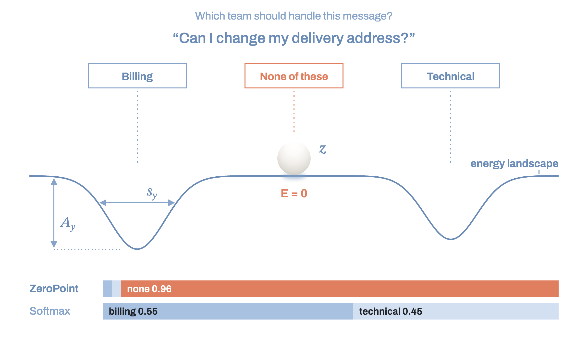

<div align="center">


<br>

# ZeroPoint: a CPU-first, energy-based decision model

**Picks the option that fits,**

**or says none does,**

**without being told that none is an option**

<br>

[](https://github.com/Javihaus/zeropoint/blob/main/LICENSE)
[](https://pypi.org/project/zeropoint/)
[](https://pypi.org/project/zeropoint/)
[](https://javihaus.github.io/zeropoint/)

[](https://github.com/Javihaus/zeropoint/actions/workflows/tests.yml)
[](https://slsa.dev)
[](https://scorecard.dev/viewer/?uri=github.com/Javihaus/zeropoint)

<br>

</div>

ZeroPoint is a small energy-based model. It measures how well each option fits the text and compares it with a fixed
level, zero, that stands for *none of these*. An option that fits no better than zero gets almost no probability,
so ZeroPoint can answer *none* with confidence.

<br>

<p><b>How to read the numbers.</b> Half of the cases have no right option. A random guess, with
<i>none</i> counted as one more option, gets about 13% right. Always answering <i>none</i> gets
50% on the first row and 0% when one option is right.</p>

<table>
<thead>
<tr><th></th><th><br>ZeroPoint</th><th>Strands Decider 2B ¹</th><th>Clef-flash ²</th><th>Semantic Router</th><th>Zero-shot NLI</th></tr>
</thead>
<tbody>
<tr><td><b>Accuracy</b>: right answer, <i>none</i> included</td><td>53.6%</td><td><b>58.6%</b></td><td>53.3%</td><td>19.4%</td><td>20.7%</td></tr>
<tr><td><b>Same answer whatever the order</b>: decisions that change when the same options are listed in another order. Lower is better</td><td><b>0%</b></td><td>7.3%</td><td>0%</td><td>0.6%</td><td><b>0%</b></td></tr>
<tr><td><b>Accuracy</b> when one option is right</td><td>43.8%</td><td><b>58.4%</b></td><td>56.2%</td><td>38.9%</td><td>41.3%</td></tr>
<tr><td><b>Silent mistakes</b>: no option fits, yet it answers with ≥ 90% confidence. Lower is better</td><td>7.8%</td><td><b>0.0%</b></td><td>5.8%</td><td>– ³</td><td>22.2%</td></tr>
<tr><td><b>Confident when right</b>: right answers stated with ≥ 90% confidence. Higher is better, and it is what makes the row above comparable: a model that never states 90% cannot make a silent mistake</td><td><b>66%</b></td><td>37%</td><td>⟨Clef⟩%</td><td>– ³</td><td>⟨NLI⟩%</td></tr>
<tr><td><b>Latency</b>, median on a CPU (on a GPU)</td><td><b>42 ms</b></td><td>6,770 ms (93 ms)⁴</td><td>+ 20,000 ms (156 ms)⁵</td><td><b>17 ms</b></td><td>1,697 ms</td></tr>
<tr><td><b>Model size</b></td><td><b>89 MB</b></td><td>4.8 GB</td><td>19 GB</td><td>91 MB</td><td>369 MB</td></tr>
<tr><td><b>Runs on</b></td><td><b>CPU</b></td><td>GPU</td><td>GPU</td><td>CPU</td><td>CPU or GPU</td></tr>
</tbody>
</table>

<sub>Measured on the three tests no model is likely to have seen in training: a 2,000-case test and two
support-ticket tests, 300 cases of each, 900 in all, half of them with no right option. ZeroPoint, Semantic Router
and zero-shot NLI on a 2-core CPU with 2 threads, one case at a time. Semantic Router 1.1.1 with its default
encoder; zero-shot NLI with DeBERTa-v3-base. ¹ AWS, Apache 2.0, and ² Cloudflare, Apache 2.0, each with "None of
these" added to every list as one more option, so that it can answer <i>none</i>. ³ Semantic Router gives
similarities, not probabilities. ⁴ On a CPU: measured on another 2-core CPU, on 118 cases of the 2,000-case test,
where ZeroPoint takes 18 ms. On a GPU: an NVIDIA L4, on the 900 cases. ⁵ On a CPU: not measured, because
Clef-flash needs about 19 GB of memory; a lower bound estimated from its size, 4.5 times that of Strands Decider.
On a GPU: an NVIDIA L4, on the 900 cases. Per-test results, other confidence thresholds and the scripts to run it
all again: <a href="https://github.com/Javihaus/zeropoint/blob/main/BENCHMARK.md">BENCHMARK.md</a>.</sub>

<br>

> [!IMPORTANT]
> Hosted LLMs, through an API, are right in 57–60% of these cases, a few points more than ZeroPoint, and take 18 to
> 55 times longer.
> See the details [here](https://github.com/Javihaus/zeropoint/blob/main/BENCHMARK.md#the-hosted-llms).

<br>

## ZeroPoint at a glance

<table>
<tr>
<th width="25%">Size</th>
<th width="25%">Latency</th>
<th width="25%">Deterministic</th>
<th width="25%">Multilingual</th>
</tr>
<tr>
<td valign="top"><h3>89 MB, no GPU</h3><sub>The model ships inside the package: nothing is downloaded at run time. Strands Decider needs 4.8 GB and a GPU; Clef-flash 19 GB.</sub></td>
<td valign="top"><h3>42 ms on a CPU</h3><sub>Median on the tests above, on 2 CPU cores. On another 2-core CPU, ZeroPoint takes 18 ms per decision and Strands Decider 6.8 s.</sub></td>
<td valign="top"><h3>Same input, same answer</h3><sub>The order of the options never changes the decision; Strands Decider's changes in 7% of cases, and in 13% of support tickets whose own queue is not on the list. Same decisions on Linux, macOS and Windows, tested on every change.</sub></td>
<td valign="top"><h3>25 languages</h3><sub>EU languages in the Latin script, plus Catalan, Basque and Galician. <a href="https://github.com/Javihaus/zeropoint/blob/main/LANGUAGES.md">Which ones, and why</a>.</sub></td>
</tr>
</table>

<br>


Routing a support ticket, finding the intent behind a request, sending a document to the right process: each means picking one option from a list. A classifier always picks something, even when the right option is not on the list or the text has nothing to do with the task. ZeroPoint can answer *none*, and the probability of *none* comes out of the same calculation as the probability of each option.

<br>

## Quick start

```bash
pip install zeropoint
```

```python
from zeropoint import ZeroPoint

zp = ZeroPoint()
zp.decide("Can you move 200 euros from my savings to my checking account?",
          ["transfer", "balance", "pay bill"])
```

```text
transfer  0.77  ███████████████·····
balance   0.02  ····················
pay bill  0.01  ····················
none      0.20  ████················
→ transfer · 12 ms
```

<br>

When none of the options fits, ZeroPoint says so:

```python
zp.decide("Set an alarm for 6:30 tomorrow morning", ["transfer", "balance", "pay bill"])
```

```text
pay bill  0.00  ····················
transfer  0.00  ····················
balance   0.00  ····················
none      1.00  ████████████████████
→ none · 12 ms
```

<br>

The options can be any short text, in any of the supported languages:

```python
zp.decide("Me han cobrado dos veces la suscripción de marzo, ¿podéis devolverme el duplicado?",
          ["facturación", "soporte técnico", "recursos humanos"])
```

```text
facturación       0.76  ███████████████·····
soporte técnico   0.00  ····················
recursos humanos  0.00  ····················
none              0.24  █████···············
→ facturación · 16 ms
```

See the Docs: [javihaus.github.io/zeropoint](https://javihaus.github.io/zeropoint/).

<br>

## Integration

ZeroPoint runs in your process: one call per decision, no network, no GPU, no service to run.
In a routing pipeline, gate on confidence: auto-route above your threshold and escalate the rest
to human review.

```python
d = zp.decide(text, ["transfer", "balance", "pay bill"])

if d.choice is None or d.confidence < 0.8:
    send_to_person(text)        # no option fits, or ZeroPoint is not sure enough
else:
    route(text, d.choice)       # e.g. "transfer"
```

The right threshold depends on what a wrong action costs you; pick it on a few hundred of your own labelled texts.

| Attribute | Description |
|---|---|
| `choice` | the chosen option, or `None` when *none* is the most probable answer |
| `confidence` | probability of `choice` (of *none* when `choice` is `None`) |
| `p_none` | probability that none of the options fits |
| `probabilities` | probability of each option, in the order you gave them; with `p_none` they add up to 1 |
| `depths` | how strongly the text belongs to each option (near 0: not at all) |
| `text_truncated` | `True` if the text was longer than ZeroPoint reads (192 word pieces) and its end was ignored |
| `options_truncated` | options longer than 16 word pieces, whose end was ignored |
| `blocks` | how many reads of 20 options the list needed |
| `latency_ms` | time the decision took |

<br>

> [!NOTE]
> For many texts, `zp.decide_many(texts, options)` takes one list of options for all texts, or one list per text.
Each text is computed on its own, so every result is exactly what `decide` gives for that text alone. Lists can be of any length. ZeroPoint reads the options in blocks of 20 together with the text, and every option's probability comes from one distribution over the whole list.

<br>

> [!TIP]
> The option `ZeroPoint(threads=2)` sets how many CPU threads the encoder uses. The decisions do not depend on it.

<br>

## Calibration

You can calibrate ZeroPoint on your own labelled data, on a CPU.

```bash
pip install torch --index-url https://download.pytorch.org/whl/cpu   # optional: CPU-only PyTorch, without the GPU libraries
pip install "zeropoint[fit]"        # adds PyTorch and onnx; deciding never needs them
```

```python
mine, report = zp.fit(texts, labels)   # labels: the right option for each text, or None for "none of these"
print(report["before"], report["after"])
mine.save("my-model")

zp = ZeroPoint("my-model")
```

> [!NOTE]
> `fit` keeps 20% of your examples apart and reports how the model does on them before and after. Same data, same
seed and same number of threads give the same model, bit for bit. On the support-ticket tests above, 300 labelled tickets raised the share of right queues from 24% to 36% when the queue is on the list, and from 29% to 46% against unrelated texts. Confident answers when the ticket's own queue is missing went from 20% to 0%. A fit is 200 steps and takes about 4 to 12
minutes on 2 CPU threads, depending on the CPU.

> [!WARNING]
> With few examples the held-out part is small, and the report's numbers move a lot by chance. `fit` and
`recalibrate` warn when fewer than 50 examples are held out.

> [!TIP]
> If your labels are already the ones ZeroPoint knows and you only want to move the balance between acting and
answering *none*, `zp.recalibrate(texts, labels)` refits just two numbers, in seconds, without PyTorch.

<br>

## How it works

<div align="center">



</div>

ZeroPoint is an energy-based model, in the sense of LeCun et al. (2006) ¹. It does not write an answer. It gives each option an energy: a number that measures how compatible the option is with the text, low when they fit and high when they do not. Training shapes these energies, pushing down the energy of the right option and pushing up the energy of the others. The text and all the options are read together, in one pass of a small multilingual encoder, so each option is measured against the text and against the other options.

Energies become probabilities with Boltzmann’s rule, the rule physics uses for a system in equilibrium: the lower the energy of a state, the more probable it is. A classifier applies the rule to the options alone, so one of them always wins, even when the text has nothing to do with any of them. ZeroPoint adds one more state, *none of the options*, with its energy fixed at zero: the flat ground around the wells the options form. Each option counts only by how far it falls below that ground. An option that does not fall below it gets nothing, however many such options there are, and *none* gets its probability in the same step as every option.

<br>

<sub>¹ Y. LeCun, S. Chopra, R. Hadsell, M. Ranzato and F. J. Huang, <a href="https://yann.lecun.com/exdb/publis/pdf/lecun-06.pdf">A Tutorial on Energy-Based Learning</a>, in <i>Predicting Structured Data</i>, MIT Press, 2006.</sub>

<br>

## Citation

```bibtex
@software{marin_zeropoint_2026,
  author = {Marín, Javier},
  title  = {ZeroPoint: a CPU-first, energy-based decision model},
  year   = {2026},
  url    = {https://github.com/Javihaus/zeropoint}
}
```

<br>

## License

ZeroPoint was trained only on data whose licence allows commercial use:

| Data | Licence |
|---|---|
| CLINC150 | CC BY 3.0 |
| Banking77, MASSIVE (English and Spanish) | CC BY 4.0 |
| Bitext customer support, banking, insurance and telco | CDLA-Sharing 1.0 |
| 5,000 examples written for this project | Apache 2.0 |

No data with a non-commercial licence was used for training, and none of the test texts above is in the training
data. Details, with the criteria used to write the 5,000 examples, in
[docs/training-data.md](https://github.com/Javihaus/zeropoint/blob/main/docs/training-data.md).

The code is Apache 2.0. The model is built on
[multilingual-e5-small](https://huggingface.co/intfloat/multilingual-e5-small) (MIT licence); the notices are in
[NOTICE](https://github.com/Javihaus/zeropoint/blob/main/NOTICE).

<br>

<div align="center">

<sub>Copyright Javier Marín, 2026</sub>

</div>
