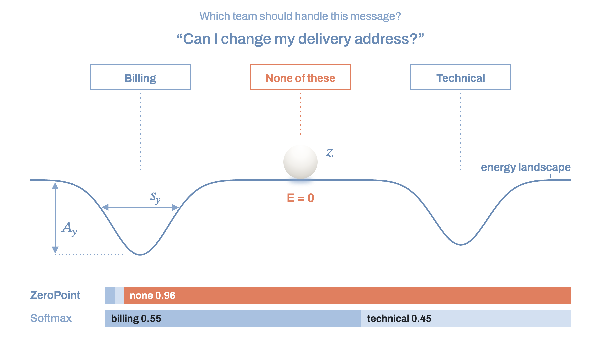
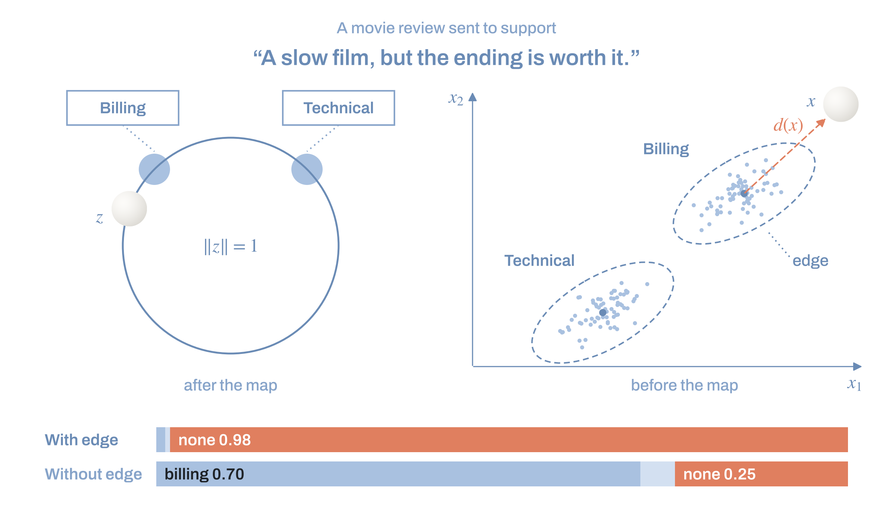
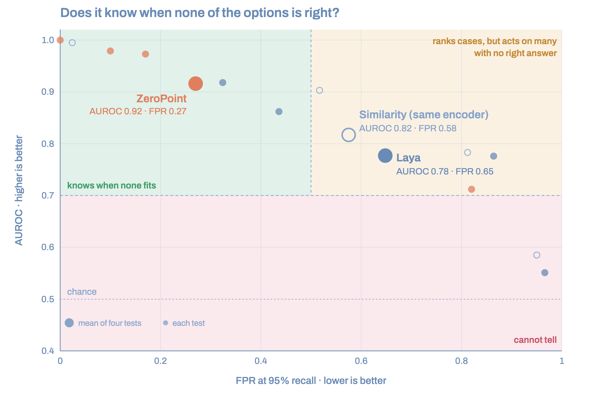

<div align="center">


<br>

# ZeroPoint: energy-based System 1 decision engine

<br>

[](https://github.com/Javihaus/zeropoint/blob/main/LICENSE)
[](https://pypi.org/project/zeropoint/)
[](https://pypi.org/project/zeropoint/)
[](https://github.com/Javihaus/zeropoint/actions/workflows/tests.yml)
[](https://www.bestpractices.dev/projects/16100)
[](https://scorecard.dev/viewer/?uri=github.com/Javihaus/zeropoint)

<br>

### :dart: A decision engine that picks an option when none is right is hallucinating

<br>

> In a single forward pass, ZeroPoint turns a text into a choice among a list of options, with *none of them* as one of the possible answers.

<br>

</div>

Results on CLINC150:

| | ZeroPoint | Laya | Jev | Similarity |
|---|---|---|---|---|
| Latency per decision | **19 ms** on a 2-core CPU | 33 ms on a T4 GPU; 193–464 ms on CPU | 70–500 ms | 15 ms on a 2-core CPU |
| Picks the right option when it is on the list | **97%** | 95% | not public | 80% |
| Out-of-scope requests still acted on, keeping 95% of the answerable ones | **10%** | 32% | not public | 52% |

<sub>1,600 CLINC150 cases never seen in training (800 answerable requests and 800 out-of-scope requests, 20
options per case), the same cases for every system measured. Similarity uses the same encoder as ZeroPoint.
Latency: ZeroPoint and similarity were measured with the benchmark in this repository; Laya and Jev as
published by their authors ([Laya](https://pypi.org/project/laya/), [Jev](https://www.truefoundry.com/blog/typesafe-ai-jev)).
Full results are in [BENCHMARK.md](BENCHMARK.md).</sub>

<br>

Decision engines pick from a list: the support queue for a ticket, the intent behind a request, the route
for a document. A classifier always picks something, even when the right option is not on the list or the
text has nothing to do with the task. ZeroPoint returns the best option or `None`, and the probability of
*none* comes out of the same calculation as the probability of each option.

<br>

## Quick start

```bash
pip install zeropoint
```

ZeroPoint answers one question: which of these options fits this text, if any. It decides with an **energy
landscape** that knows a set of options and is calibrated on real texts. Two landscapes come with the package.

### Default energy landscape

`ZeroPoint.load()` loads the default landscape, `everyday`: 150 kinds of everyday requests to an assistant.

**Case 1: one of the options is right.**

```python
from zeropoint import ZeroPoint

zp = ZeroPoint.load()
zp.decide("Can you move 200 euros from my savings to my checking account?",
          options=["transfer", "balance", "pay bill"])
```

Output:

```text
transfer  0.98  ███████████████████▋
balance   0.01  ▏
pay bill  0.00
none      0.01  ▏
→ transfer · 9 ms
```

**Case 2: none of the options is right.**

```python
zp.decide("Set an alarm for 6:30 tomorrow morning",
          options=["transfer", "balance", "pay bill"])
```

Output:

```text
pay bill  0.00
transfer  0.00
balance   0.00
none      1.00  ███████████████████▉
→ none · 8 ms
```

<br>

### Support energy landscape

`ZeroPoint.load("support")` loads a landscape calibrated on customer support tickets. It routes each ticket to
one of 10 queues.

**Case 1: three options, and it chooses one.**

```python
zp = ZeroPoint.load("support")
zp.decide("Subject: Charged twice for my subscription\n"
          "Hello, my credit card was charged twice for the March invoice. Could you refund the duplicate payment?",
          options=["Billing and Payments", "Technical Support", "Human Resources"])
```

Output:

```text
Billing and Payments  0.91  ██████████████████▏
Human Resources       0.00
Technical Support     0.00
none                  0.09  █▊
→ Billing and Payments · 14 ms
```

**Case 2: no options given.**

When no list is passed, ZeroPoint chooses among all the options the landscape knows, here its 10 queues
(listed in `zp.labels`). The output shows the five most probable.

```python
zp.decide("Subject: Service down since this morning\n"
          "Our dashboard has been unreachable since 8am and all requests time out. "
          "Is there an outage or scheduled maintenance?")
```

Output:

```text
Service Outages and Maintenance  0.83  ████████████████▋
IT Support                       0.05  █
Technical Support                0.03  ▌
Human Resources                  0.01  ▎
Product Support                  0.01  ▏
                                 (+5 more options)
none                             0.06  █▏
→ Service Outages and Maintenance · 12 ms
```

The support landscape knows tickets written in the style of its dataset (a subject line and a body) and
treats very different writing as outside what it knows. For your own tickets, calibrate a landscape on your
own data.

<br>

## Energy-based models

<br>



ZeroPoint is an energy-based model ([LeCun et al., 2006](http://yann.lecun.com/exdb/publis/orig/lecun-06.pdf)).
Instead of scoring options against each other, it gives every option an energy and compares it with a
reference state whose energy is fixed. In physics, energy is always measured relative to a reference level,
just as a mountain's height is measured from sea level. ZeroPoint fixes that level once: an option counts
only if the text sits below it, in that option's valley. A useful image is a ball on a floor with holes: it
either drops into a hole (an option) or stays on the flat floor (none of the options).

#### 1. The text

ZeroPoint uses [multilingual-e5-small](https://huggingface.co/intfloat/multilingual-e5-small), a frozen
multilingual encoder that turns the text into a vector. A small learned map places it as a point $z$ in a
space of 256 dimensions.

#### 2. The options

Each option $y$ is a well in that space, built from the option's own text, with a center $c_y$, a depth
$A_y$ and a width $s_y$:

$$E_y(z) = -A_y \exp\left(-\frac{\lVert z - c_y \rVert^2}{s_y^2}\right)$$

Near the center the energy is low. Far from it the well is flat and the energy is exactly zero.

#### 3. The vacuum

*None of the options* is a state of its own: the flat ground of the landscape, with its energy fixed at zero.
This is the zero point, and it is the core of the approach.

A classifier gives each option a score and divides the probability among the options with a softmax. The
probabilities always add up to 1 across the options, so one of them always wins, even when the text has
nothing to do with any of them. The next section shows how ZeroPoint avoids this.

#### 4. Boltzmann's rule: from energy to probability

In physics, Boltzmann's rule describes how likely a system is to be found in each of its states: the lower a
state's energy, the more likely the state, exponentially so. A temperature $T$ sets how sharp the preference
is. At low temperature the lowest state takes almost all the probability; at high temperature the states are
close to equally likely.

$$p(\text{state}) \propto e^{-E_{\text{state}}/T}$$

A softmax classifier applies exactly this rule to the options only.

> **The plain rule is not enough.** Adding *none* as one more state, at energy zero, and applying the rule as
> it is does not solve the problem. A text far from every well also has energy zero in every well, so each
> option gets the same weight as *none*, $e^{0} = 1$. With 2 options, *none* gets only a third of the
> probability. With 150 options, it gets 1/151, less than 1%. The plain rule cannot say *none* with
> confidence.

ZeroPoint weights each option by how far its energy falls *below* the ground, not by its energy alone. With a
temperature $T$ learned during calibration:

$$w_y = e^{-E_y/T} - 1, \qquad w_{\text{none}} = 1, \qquad p(y) = \frac{w_y}{w_{\text{none}} + \sum_k w_k},
\qquad p(\text{none}) = \frac{1}{w_{\text{none}} + \sum_k w_k}$$

On the ground, $E_y = 0$ and $w_y = 0$: an option that does not fall below the ground adds nothing, however
many such options there are. Deep in a well, $w_y$ grows exponentially and that option wins. The ground keeps
a weight of 1 in every landscape, and that fixed reference is the zero point.

Example: two texts and two options, Billing and Technical, at temperature 1.

| Text | Energy in Billing | Energy in Technical | Softmax | Boltzmann with *none* | ZeroPoint |
|---|---|---|---|---|---|
| *I was charged twice this month* | −3.00 | 0.00 | billing 0.95, technical 0.05 | billing 0.91, none 0.05 | **billing 0.95**, none 0.05 |
| *Can I change my delivery address?* | −0.05 | −0.04 | billing 0.50, technical 0.50 | billing 0.34, technical 0.34, none 0.32 | billing 0.05, technical 0.04, **none 0.92** |

With the first text, the three rules agree. The second text lies in neither well. Softmax still has to split
all the probability between the two options and answers *billing*. ZeroPoint finds that neither option falls
below the ground and answers *none*. Because the ground never moves, *none* is an outcome of the model in its
own right, not a remainder.

#### 5. The edge of the data: off-topic texts



The learned map places every text on the surface of a sphere: every point has length 1. On a sphere there is
no "far away". Every text, even one unlike anything the landscape has seen, lands somewhere on that surface,
and it can land close to a well by chance. A movie review given to the support landscape can end up near
*Billing*, and the rule above would then give *billing* some probability. In the benchmark, without this
correction, ZeroPoint separated support tickets from reviews and forum posts with an AUROC of only 0.68.

To correct this, ZeroPoint asks a simpler question in the encoder's own space, before the map, where unrelated
texts are far apart: *does this text resemble the texts this landscape was calibrated on?* It answers with the
**Mahalanobis distance** ([Mahalanobis, 1936](https://link.springer.com/article/10.1007/s13171-019-00164-5)).

- **How far.** An ordinary distance treats every direction the same. The Mahalanobis distance takes into
  account how the calibration texts spread out: in directions where they vary a lot, a step counts less; in
  directions where they barely vary, the same step counts more. A text that is unusual in a way the
  calibration texts never are ends up far away, even when an ordinary distance would place it close.
  ZeroPoint measures this distance from the text $x$ to the nearest known class:

$$d(x) = \min_c \,(x - \mu_c)^\top \, \Sigma^{-1} \,(x - \mu_c)$$

  where $\mu_c$ is the average of the calibration texts of class $c$, and $\Sigma$ describes how they spread
  around those averages (one covariance shared by all classes, estimated with Ledoit-Wolf shrinkage so that
  it stays stable with few texts).
- **Where the edge is.** Calibration measures $d$ for in-domain texts that were not used for training. The
  edge is the distance within which 99% of them fall (the 99th percentile).
- **What happens beyond it.** Inside the edge, nothing changes. Beyond it, the weight of the ground grows with
  the distance past the edge, so the probability moves to *none*:

$$w_{\text{none}} = e^{\kappa \cdot \max(0,\,u)}, \qquad \kappa = 2$$

$u$ is the distance rescaled so that $u = 0$ at the edge and $u = 1$ one typical spread beyond it (the gap
between the median distance and the 99th percentile). One spread beyond the edge, the ground weighs
$e^2 \approx 7$ instead of 1. Three spreads beyond, it weighs about 400, and *none* takes almost all the
probability.

With the edge, the same test goes from 0.68 to 1.00. The edge has three properties:

- it is set from in-domain texts only, so no *out-of-scope* examples are needed;
- it never changes which option ranks first among the options, only how they compare with *none*;
- inside the data, where almost all real requests fall, it has no effect.

Calibration learns the map, the wells and the temperature from labeled texts. During training, a share of
the examples have their right option removed from the list, with *none* as the answer, so that the model
learns to leave the probability with the vacuum when no option fits.

> Related work: deterministic uncertainty with distances to class centroids ([van Amersfoort et al., 2020](https://arxiv.org/abs/2003.02037)), Mahalanobis distance to class averages for detecting off-topic inputs ([Lee et al., 2018](https://arxiv.org/abs/1807.03888)), and world models whose energy is learned up to a constant ([Yalovetzky et al., 2026](https://arxiv.org/abs/2610.15267)). In ZeroPoint the constant is fixed, and that is what makes it possible to answer *none*.

<br>

## Choosing the energy landscape

A landscape is what ZeroPoint knows: one valley for each option it can choose, and flat ground at energy zero
that means *none of these*. It is calibrated from labeled texts.
[Energy-based models](#energy-based-models) explains how it decides.

```python
import zeropoint
zeropoint.landscapes()  # lists the landscapes that ship with ZeroPoint
```

Output:

```text
everyday    150 options   everyday requests to an assistant: banking, travel, home, work, small talk   (default)
support      10 options   customer support tickets, routed to a queue
```

| Landscape | What it decides | Calibrated on |
|---|---|---|
| `everyday` (default) | 150 kinds of everyday requests | [CLINC150](https://huggingface.co/datasets/clinc_oos), 15,000 requests written by people |
| `support` | 10 support queues | a [public dataset](https://huggingface.co/datasets/Tobi-Bueck/customer-support-tickets) of 20,000 support tickets |

> Each landscape comes with two encoders: `encoder="small"` (default, faster) and `encoder="base"` (more accurate, slower). A landscape calibrated on your own data loads the same way: `ZeroPoint.load(path)`.

<br>

## Setting a threshold

Acting on a wrong answer has a **cost**. A ticket sent to the wrong team waits for days; a request handled by
the wrong service delays the answer the customer needs. By default, ZeroPoint returns its most probable
answer, even when that answer is only 28% likely. A threshold makes it act only when it is at least that
confident and return *none* otherwise, so that the case can go to a reviewer instead.

```python
zp = ZeroPoint.load()
zp.decide("Write me a poem about the sea", min_confidence=0.5)
```

Output:

```text
timezone   0.28  █████▋
time       0.05  ▉
text       0.05  ▉
weather    0.04  ▉
what song  0.04  ▊
           (+145 more options)
none       0.16  ███▏
→ none · 7 ms
```

> The right threshold depends on the cost of a wrong action. [notebooks/calibrate_your_own.ipynb](notebooks/calibrate_your_own.ipynb) shows how to choose it from your own data.

<br>

## Calibration

To calibrate your own landscape, you need texts with their right label, a few hundred per label to start.
Examples of *none* are not needed.

```bash
pip install "zeropoint[train]"        # adds PyTorch, only needed to calibrate
```

```python
zp = ZeroPoint.fit(texts, labels,
                   descriptions={"BIL": "billing and invoices"},   # optional, helps with terse labels
                   catch_all=["Other"])                            # optional, labels that fit anything
zp.save("my_model.safetensors")

ZeroPoint.load("my_model.safetensors").decide("...")
```

The encoder stays frozen and its embeddings are computed once. If the model does not beat chance on held-out
texts by ten percentage points, `fit` stops with an error instead of returning a model that has not learned.

> To monitor training, install `zeropoint[monitor]` and pass `monitor=True`. The
> [ndt](https://pypi.org/project/ndtracker/) library tracks how many dimensions the learned space actually
> uses; a collapse shows up there even when the loss looks normal.

> A complete walk-through, with a held-out check and a table for choosing your threshold, is in
> [notebooks/calibrate_your_own.ipynb](notebooks/calibrate_your_own.ipynb).

<br>

## Accuracy

AUROC measures how well ZeroPoint separates cases that have a right option from cases that have none, on texts
it never saw (1 is perfect, 0.5 is chance). Small encoder, default settings:



| Test | ZeroPoint | Similarity, same encoder |
|---|---|---|
| Support tickets vs unrelated texts (reviews, forum posts) | **1.00** | 0.99 |
| Support tickets whose right queue was removed from the list | **0.71** | 0.59 |
| Everyday requests vs out-of-scope requests (CLINC150) | **0.98** | 0.90 |
| Everyday requests whose right intent was swapped for a wrong one | **0.97** | 0.78 |

When the right option is on the list, ZeroPoint chooses about as well as a classifier trained on the same
data: 97% on CLINC150 with 20 options per request.

<br>

## Latency

On a 2-core cloud CPU, one decision takes about 19 ms with the default settings (small encoder, 8-bit). The
base encoder takes about 30 ms. No GPU is needed, and a recent laptop is faster.

The engine itself takes a millisecond or less. Almost all the time goes to the encoder, which runs with
[ONNX Runtime](https://onnxruntime.ai) in 8-bit precision by default (`precision="fp32"` for full
precision). Details are in [BENCHMARK.md](BENCHMARK.md).

<br>

## Using ZeroPoint in your code

A common application is to route the case automatically when ZeroPoint is confident, and to pass it to a person
when it is not:

```python
d = zp.decide(text, options=["transfer", "balance", "pay bill"])

if d.choice is None:
    send_to_person(text)        # none of the options fits, or the confidence is below the threshold
else:
    route(text, d.choice)       # e.g. "transfer"
```

<br>

| Field | What it holds | Use it to |
|---|---|---|
| `choice` | the chosen option, or `None` | act, or hand the case to a person |
| `confidence` | probability of `choice` | log it, or set your own rule |
| `p_none` | probability that none of the options fits | find requests your system does not cover |
| `probabilities` | one probability per option | show the runner-up, or rank the options |
| `beyond_edge` | how far the text is from anything the landscape has seen (zero or below: familiar) | detect unusual texts, or a change in the kind of requests you receive |
| `latency_ms` | time the decision took | monitor speed in production |
| `energies` | energy of the text in each option's valley | inspect how the decision was made |

<br>

For many texts at once, use `decide_many`. It takes the same arguments, plus one list of options per text if
they differ, and returns one decision per text:

```python
decisions = zp.decide_many(texts, options=["transfer", "balance", "pay bill"])
```

<br>

## References

- LeCun, Y., Chopra, S., Hadsell, R., Ranzato, M., & Huang, F. (2006). A tutorial on energy-based learning. *Predicting Structured Data*, 1(0).
- Lee, K., Lee, K., Lee, H., & Shin, J. (2018). A simple unified framework for detecting out-of-distribution samples and adversarial attacks. *Advances in Neural Information Processing Systems*, 31.
- Mahalanobis, P. C. (1936). On the generalised distance in statistics. Reprinted in *Sankhya A*, 80 (Suppl 1), 1–7 (2018). https://doi.org/10.1007/s13171-019-00164-5
- van Amersfoort, J., Smith, L., Teh, Y. W., & Gal, Y. (2020). Uncertainty estimation using a single deep deterministic neural network. In *International Conference on Machine Learning* (pp. 9690–9700). PMLR.
- Yalovetzky, R., Balestriero, R., & LeCun, Y. (2026). LeHami: Symplectic latent dynamics for world models. arXiv preprint arXiv:2610.15267.

<br>

## Citation

```bibtex
@software{marin_zeropoint_2026,
  author = {Marín, Javier},
  title  = {ZeroPoint: an energy-based decision engine},
  year   = {2026},
  url    = {https://github.com/Javihaus/zeropoint}
}
```

<br>

## License

Apache 2.0. The encoders are downloaded from the Hugging Face Hub at first use and keep their own MIT
license.

<br>

<div align="center">

<sub>Copyright Javier Marín, 2026</sub>

</div>
