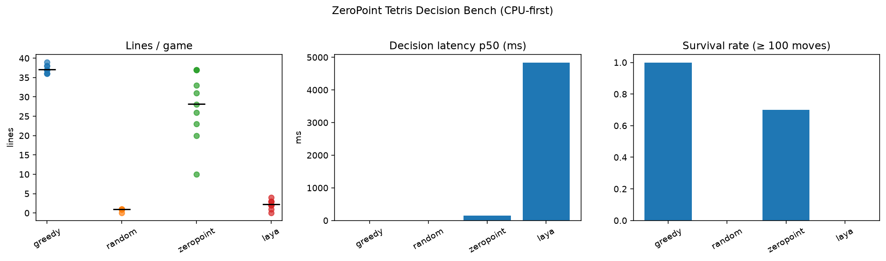

# Tetris decision-model example

Part of the ZeroPoint repo (`examples/tetris/`).

CPU-first comparison of **decision models** on a shared Tetris shortlist:
the game engine enumerates legal placements, builds a shortlist of options, and each model only chooses among those options.

## Models in this experiment

| Model | Included? | Notes |
|-------|-----------|--------|
| **greedy** | Yes | Always picks heuristic rank-1 (shortlist ceiling) |
| **random** | Yes | Uniform pick among the shortlist (floor) |
| **ZeroPoint** | Yes | Local, CPU, zero-shot |
| **Laya** | Yes | Local, **CPU-forced**, zero-shot |
| **OpenAI Decisions** | **Not run** | Deferred. This example does **not** include an OpenAI result. |

> OpenAI Decisions is wired in the notebook for a later run, but **it was not part of this experiment**. Do not treat any OpenAI numbers as measured here.

## Results (Colab CPU, 2026-11-27)

10 seeds × 100 moves, `shortlist_k=8`.

| Model | Lines (mean) | Survival ≥100 | Greedy agreement | Latency p50 |
|-------|-------------:|--------------:|-----------------:|------------:|
| greedy | 37.1 | 100% | 100% | ~0 ms |
| **zeropoint** | **28.2** | **70%** | **79%** | **146 ms** |
| laya | 2.2 | 0% | 33% | 4842 ms |
| random | 0.9 | 0% | 14% | ~0 ms |



Raw tables: [`results/summary.csv`](results/summary.csv), [`results/games.csv`](results/games.csv). Metadata: [`results/README.md`](results/README.md).

## Reproduce in Colab

1. Open [`tetris_decision_bench.ipynb`](./tetris_decision_bench.ipynb) in Google Colab.
2. Runtime → **CPU**.
3. Leave `run_openai = False` (default).
4. Run all — start with the smoke test, then the full run.

## Local

```bash
cd examples/tetris
python -m venv .venv && source .venv/bin/activate
pip install -r requirements.txt
jupyter notebook tetris_decision_bench.ipynb
```

## Fairness

- Same seeds, board, shortlist, and option wording for every model
- Laya forced to CPU (`CUDA_VISIBLE_DEVICES=""`)
- Zero-shot only (no Tetris fine-tunes)
